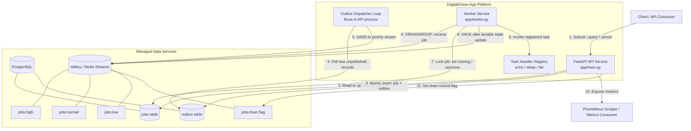
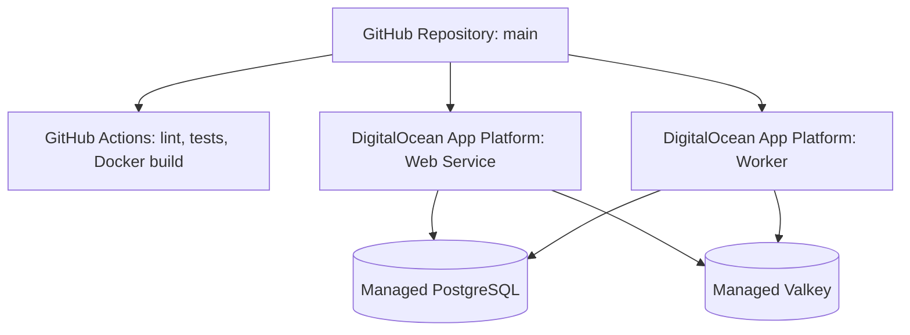
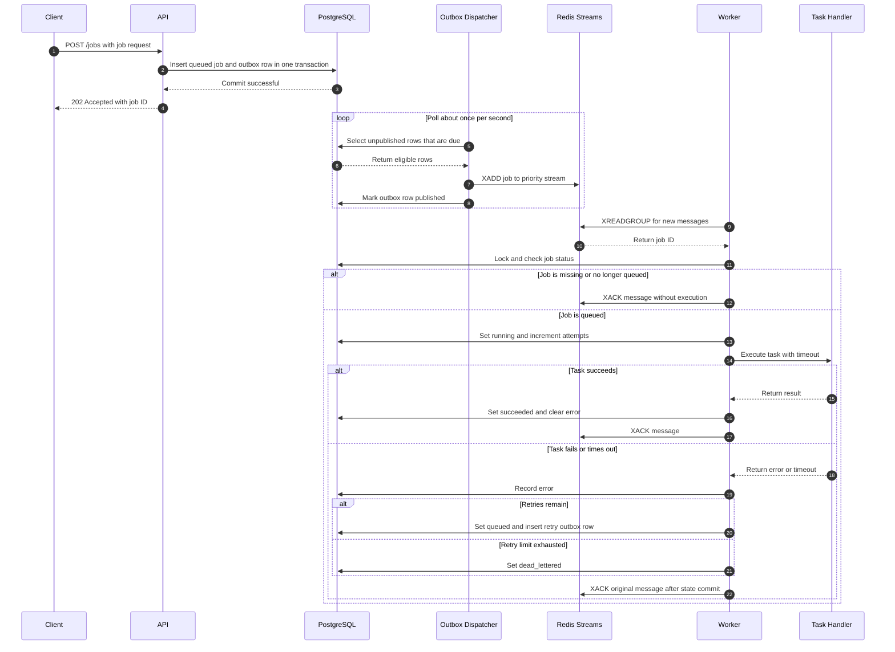
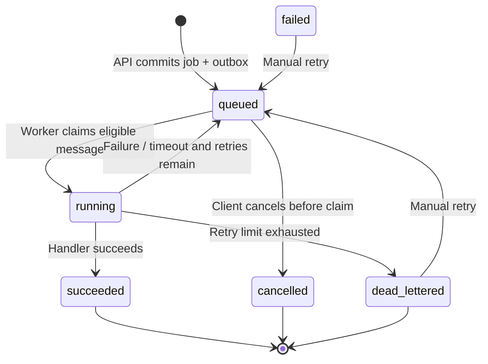

# Design: Asynchronous Jobs API

## 1. Overview

This service accepts work over HTTP, persists job state and dispatch intent in PostgreSQL, publishes due outbox records to Redis Streams (DigitalOcean Valkey in the deployed environment) through a dedicated dispatcher component, and executes jobs in a separate worker process. The API, dispatcher, and worker share a repository and Docker image but run as separate DigitalOcean App Platform components so they can be scaled and configured independently.

**Design principle:** PostgreSQL is the source of truth for job lifecycle state. Redis Streams is the delivery/dispatch mechanism, not the authoritative job record.

## Layered API architecture

The HTTP API is split into three layers so transport concerns, job rules, and persistence can evolve independently.

| Layer | Location | Responsibilities |
|---|---|---|
| **Activity layer** | `app/activities/jobs.py` | FastAPI routes, Pydantic request/response validation, HTTP status mapping, headers, and response serialization. It delegates work instead of issuing SQL or Redis commands directly. |
| **Business logic layer** | `app/services.py` | Job lifecycle rules, idempotent submission behavior, cancellation/retry eligibility, queue-drain confirmation, and domain exceptions independent of HTTP. |
| **Model / data-access layer** | `app/repositories.py` and `app/db.py` | Repository operations and transaction boundaries; SQLAlchemy ORM models, sessions, and PostgreSQL engine configuration. |
| **Application bootstrap** | `app/main.py` | Creates the FastAPI app, initializes the schema for this assignment, registers activity routes, and exposes health/metrics endpoints. |

The dispatcher and worker remain separate deployable processes. They share the database engine's connection/pool timeout configuration and the common Redis client factory; the API's activity/service/repository split does not combine these runtime components.

## Network timeouts and retry policy

Network operations are bounded to avoid indefinitely tying up API threads or background workers. Defaults are configurable through environment variables.

| Setting | Default | Purpose |
|---|---:|---|
| `DB_CONNECT_TIMEOUT_SEC` | 5 seconds | PostgreSQL connection establishment timeout |
| `DB_POOL_TIMEOUT_SEC` | 5 seconds | Maximum wait for a SQLAlchemy pooled connection |
| `DB_STATEMENT_TIMEOUT_MS` | 5000 ms | PostgreSQL server-side statement timeout |
| `REDIS_SOCKET_CONNECT_TIMEOUT_SEC` | 2 seconds | Redis/Valkey connection establishment timeout |
| `REDIS_SOCKET_TIMEOUT_SEC` | 3 seconds | Redis/Valkey socket operation timeout |
| `EXTERNAL_RETRY_ATTEMPTS` | 3 attempts | Total attempts for retry-enabled operations |
| `EXTERNAL_RETRY_BASE_DELAY_SEC` | 0.1 seconds | Initial exponential-backoff ceiling |
| `EXTERNAL_RETRY_MAX_DELAY_SEC` | 1 second | Maximum backoff ceiling |

- **Backoff:** retry-enabled database operations use capped exponential backoff with full jitter. With the defaults, delay ceilings grow from 100 ms to 200 ms and are capped at 1 second.
- **Database retry classification:** retry connection/transport errors such as SQLAlchemy `OperationalError`, `InterfaceError`, and invalidated connections. Do not retry validation errors or integrity/constraint violations.
- **Redis retry classification:** the shared Redis client retries connection and socket-timeout failures using redis-py's retry support. API drain, dispatcher, and worker use this shared client factory.
- **Transactional safety:** database repository operations create a fresh session for each attempt. Job creation reuses a stable UUID across retries and checks the idempotency key. The dispatcher may publish an `XADD` before its database commit succeeds, so a retry can duplicate a message; delivery remains at-least-once and handlers must tolerate duplicates.
- **Failure response:** if retries are exhausted, the error is allowed to propagate to the activity layer (database failures become server errors; Redis queue-control failures return `503 Service Unavailable`). Retries are bounded; there is no infinite retry loop.
- **Scope:** the shared engine and Redis client timeouts apply to API, dispatcher, and worker. Explicit database retry wrappers are used by API repository operations and dispatcher batches; worker lifecycle transactions rely on bounded DB timeouts and should not be blindly retried as whole units because they can surround task side effects or enqueue a retry record.


## 2. Goals and scope

### In scope

- Submit asynchronous jobs and return quickly with `202 Accepted`.
- Inspect a job by ID and list recent jobs, optionally filtered by status.
- Support high, normal, and low priority queues.
- Persist job state and enqueue intent atomically.
- Execute jobs in a separate worker with configurable concurrency and per-attempt timeouts.
- Retry failed attempts up to a configured limit and persist terminal dead-letter state.
- Support idempotency keys for duplicate submission requests.
- Support one-time scheduled execution with `run_at`.
- Cancel jobs that are still queued, manually retry failed/dead-lettered jobs, and expose queue-depth and Prometheus metrics.
- Run automated unit and integration tests in GitHub Actions.

### Out of scope / deferred

- Cron/recurring schedules.
- A separate Redis dead-letter stream; terminal dead-letter state is stored in PostgreSQL.
- A full administrative UI, authentication/authorization policy, tenant isolation, and per-customer quotas.
- Strict global priority ordering across all priority classes.
- Exactly-once execution of arbitrary task side effects.

## 3. Functional requirements

| ID | Requirement | Current behavior |
|---|---|---|
| FR-1 | Submit a job | `POST /jobs` validates input, stores a job and outbox record, and returns `202 Accepted`. |
| FR-2 | Read a job | `GET /jobs/{job_id}` returns persisted lifecycle details or `404`. |
| FR-3 | List jobs | `GET /jobs?status=queued&limit=100` lists recent jobs, optionally filtered by status. |
| FR-4 | Prioritize jobs | `high`, `normal`, and `low` map to `jobs:high`, `jobs:normal`, and `jobs:low` Redis Streams. |
| FR-5 | Execute asynchronously | Worker consumer groups read stream messages and execute registered task handlers. |
| FR-6 | Bound execution time | Each attempt runs in a child process and is terminated if it exceeds `timeout_sec`. |
| FR-7 | Retry failures | A failed attempt is returned to `queued` while retries remain; otherwise it becomes `dead_lettered`. `max_retries` counts retries after the initial attempt. |
| FR-8 | Avoid duplicate submissions | `Idempotency-Key` returns the existing job for a repeated key and sets `Idempotency-Replayed: true`. |
| FR-9 | Cancel queued jobs | `DELETE /jobs/{job_id}` cancels only queued jobs; other states return `409`. |
| FR-10 | Manually retry terminal jobs | `POST /jobs/{job_id}/retry` resets a failed/dead-lettered job and creates a new outbox record. |
| FR-11 | Schedule a one-time job | A future `run_at` keeps its outbox record unpublished until its scheduled time. |
| FR-12 | Inspect queue depth | `GET /queue/depth` returns counts of queued PostgreSQL jobs by priority. These are DB state counts, not exact Redis stream lengths. |
| FR-13 | Drain/pause consumption | `POST /queue/drain` requires `{"confirm": true}` and sets a Redis flag that tells workers to stop claiming new jobs. A resume endpoint is not currently implemented. |
| FR-14 | Health and metrics | `GET /health` returns a basic health response; `GET /metrics` exposes Prometheus metrics. |

### Job request fields

- `task_type`: required handler name, 1–100 characters.
- `payload`: JSON object, defaults to an empty object.
- `priority`: `high`, `normal`, or `low`; defaults to `normal`.
- `max_retries`: 0–20; defaults to 3 retries after the first attempt.
- `timeout_sec`: 1–3600 seconds; defaults to 30 seconds per attempt.
- `run_at`: optional timestamp for one-time scheduling.

The current worker includes sample `echo`, `sleep`, and `fail` handlers. New task types must be explicitly registered/implemented in the worker.

## 4. Non-functional requirements

These are design goals; numeric service-level objectives have not yet been benchmarked.

| ID | Requirement | Approach / qualification |
|---|---|---|
| NFR-1 | Durability | Job and outbox intent commit together in PostgreSQL. |
| NFR-2 | Delivery reliability | Outbox dispatcher publishes to Redis Streams; consumer groups coordinate delivery. Delivery is at-least-once, not exactly-once. |
| NFR-3 | Duplicate tolerance | Idempotency keys protect repeated API submissions. Task handlers should also be idempotent because a worker may repeat side effects after failures. |
| NFR-4 | Fault isolation | API and worker are separate App Platform components; a worker failure need not make HTTP submission unavailable if dependencies remain healthy. |
| NFR-5 | Horizontal scalability | API instances and worker containers can be scaled separately. Worker concurrency is controlled by `WORKER_CONCURRENCY`. |
| NFR-6 | Bounded resource use | Worker concurrency is bounded; each task attempt has a timeout. Memory/CPU limits and database connection pools must be sized with concurrency. |
| NFR-7 | Observability | Application logs plus Prometheus counters/gauges expose submissions, cancellations, and pending outbox count. |
| NFR-8 | Maintainability | FastAPI, SQLAlchemy, Pydantic, Redis Streams, Docker, and pytest are used with explicit API and worker entry points. |
| NFR-9 | Security | Use TLS for managed database/cache connections, platform-managed environment variables/secrets, restricted network access, and never commit credentials. Authentication and authorization still need to be added for a public production API. |
| NFR-10 | Testability | Unit tests cover handlers/validation; integration tests use disposable PostgreSQL and Redis service containers in CI. |

## 5. Architecture

### Component diagram



The boxes inside the data-services boundary are logical tables/streams, not separate deployed services. The `outbox` table lives in PostgreSQL. The dispatcher is a separate process/service, alongside the API and worker, and can be scaled independently.

**Responsibilities and data flow**

1. **Client/API consumer:** submits a job with its task type, JSON payload, priority, retry limit, timeout, optional `run_at`, and optional `Idempotency-Key`.
2. **FastAPI service:** validates the request, checks an idempotency key when supplied, then writes the `jobs` row and its corresponding `outbox` row in one PostgreSQL transaction. It returns `202 Accepted` after the transaction commits; it does not wait for task execution.
3. **PostgreSQL:** owns the durable job state and enqueue intent. Job status and attempt count remain authoritative here; Redis stream contents are not the source of truth.
4. **Outbox dispatcher:** a dedicated component (`python -m app.dispatcher`) polls approximately once per second for unpublished rows whose job is due (`run_at` is absent or has passed). It locks eligible rows with `FOR UPDATE SKIP LOCKED`, publishes each to the priority stream, and records `published_at`.
5. **Valkey / Redis Streams:** holds dispatch messages in `jobs:high`, `jobs:normal`, or `jobs:low`. A `job-workers` consumer group distributes new messages to worker consumers. Reading the streams together means strict global priority ordering is not guaranteed.
6. **Worker:** loads and locks the corresponding PostgreSQL job, skips missing, cancelled, running, or terminal jobs, marks eligible jobs `running`, increments `attempts`, and executes the registered handler in a child process bounded by `timeout_sec`.
7. **Completion/retry path:** after execution, the worker persists `succeeded` or records the error and either returns the job to `queued` with a new outbox record or marks it `dead_lettered`. It acknowledges the Redis message after persisting the resulting state.
8. **Operations/metrics:** `GET /health` exposes basic process health, `GET /metrics` exposes the current Prometheus metrics, and `POST /queue/drain` sets a Valkey flag that pauses new worker claims. The health endpoint does not currently check dependency readiness.

**Delivery and failure semantics:** the outbox closes the database/job-enqueue dual-write gap, but publishing to Redis and marking the outbox row published are not one atomic transaction. A publish can therefore be repeated if Redis accepts the message but the PostgreSQL commit fails. The worker's database state checks reduce duplicate execution of already-transitioned jobs, but arbitrary handler side effects are not exactly-once. Automatic stale pending-message reclaim and recovery of jobs stranded in `running` are not implemented yet.

### Deployment view



The API and worker use the same repository and Dockerfile but different start commands:
- API: `uvicorn app.main:app --host 0.0.0.0 --port 8000`
- Dispatcher: `python -m app.dispatcher`
- Worker: `python -m app.worker`

## 6. Component responsibilities

### 6.1 API service — `app/main.py`

- Validates requests using Pydantic models.
- Implements REST endpoints and maps database records to response models.
- Stores each new job and its outbox record in one PostgreSQL transaction.
- Exposes health and Prometheus endpoints.
- Sets a Redis control flag for the drain/pause operation.

The health endpoint currently reports process health only; it does not actively verify PostgreSQL and Valkey connectivity.

### 6.2 PostgreSQL — `app/db.py`

- Stores the canonical `jobs` lifecycle record: ID, type, payload, priority, status, attempt count, retry limit, timeout, schedule, timestamps, error, and idempotency key.
- Stores `outbox` records that represent intent to enqueue a job.
- Uses SQLAlchemy and a PostgreSQL UUID/JSONB schema.
- Uses `create_all` at startup for this assignment; a production migration tool and versioned migrations should replace this approach.

### 6.3 Transactional outbox dispatcher — `app/dispatcher.py`

- Runs as a standalone process/component, independent of the HTTP API.
- Selects unpublished outbox rows whose scheduled time is due.
- Locks rows using `FOR UPDATE SKIP LOCKED`, publishes to the appropriate Redis Stream, and records `published_at`.
- Runs periodically, allowing an unpublished row to be retried on a later pass after a transient error.

There is a small dual-write window: Redis may accept `XADD` before the database transaction records `published_at`. If the database commit then fails, the row can be published again. This is why consumers and task side effects must tolerate duplicates.

### 6.4 Valkey / Redis Streams

- Provides three streams: `jobs:high`, `jobs:normal`, and `jobs:low`.
- Uses the `job-workers` consumer group to coordinate consumers.
- Carries the job ID and serialized task information needed for dispatch.
- Stores the `jobs:drain` control flag.

The worker reads the streams together. The current implementation does not promise strict global priority ordering. Redis stream pending-message recovery/reclaim after a consumer crash is not yet implemented; a message left pending can require operational recovery.

### 6.5 Worker — `app/worker.py`

- Creates consumer groups if they do not exist.
- Claims new messages from the priority streams.
- Loads and locks the PostgreSQL job record, skipping jobs that are no longer queued or already terminal.
- Marks the job `running`, increments `attempts`, and executes the task in a child process.
- Marks success or persists the error and either schedules another attempt through the outbox or marks the job `dead_lettered`.
- Acknowledges a stream message after persisting the resulting state.
- Handles SIGTERM/SIGINT by stopping new claims and waiting for in-flight thread-pool tasks to finish.

The current retry policy republishes eligible retries promptly; exponential backoff and jitter are not implemented. A crash after marking a job `running` also needs a recovery/reconciliation mechanism to prevent a job remaining in that state indefinitely.

### 6.6 CI and test suite

GitHub Actions runs Ruff, unit tests, integration tests against disposable PostgreSQL/Redis services, and a Docker image build. See [Testing](#7-testing) for the test suites and scenario-level coverage.

## 7. Testing

Automated tests are organized into unit tests and integration/API tests. GitHub Actions runs both on pushes to `main` and pull requests targeting `main`, then builds the Docker image. CI uses Python 3.12, PostgreSQL 16, and Redis 7 service containers; the same integration code exercises the Redis Streams behavior used by DigitalOcean Valkey.

### Test commands

```bash
pytest tests/test_unit.py
pytest tests/test_api.py tests/test_integration.py
ruff check .
docker build -t jobs-api:local .
```

### Unit-test coverage — `tests/test_unit.py`

- **Task handlers:** `echo` returns the supplied payload; `sleep` returns its requested duration; `fail` raises the expected error; unsupported task types are rejected.
- **Execution timeout wrapper:** successful task results are returned, handler failures propagate, and a task that exceeds its timeout is stopped and raises a timeout error.
- **Request-model defaults:** verifies the default `normal` priority, empty payload, 3 retries, and 30-second timeout.
- **Request validation:** rejects an empty task type, unsupported priority, zero timeout, and negative retry count.

### API and integration coverage — `tests/test_api.py` and `tests/test_integration.py`

- **Job submission and retrieval:** submitting a valid job returns `202 Accepted` with `queued` status, and the job can be retrieved by ID.
- **Idempotent submission:** repeating a request with the same `Idempotency-Key` returns the same job, sets `Idempotency-Replayed: true`, and does not create duplicate job or outbox rows.
- **Input validation over HTTP:** invalid job input returns `422 Unprocessable Entity`.
- **Listing and status filtering:** the jobs list can filter by status and excludes jobs in other states.
- **Cancellation rules:** queued jobs can be cancelled; cancellation of a non-queued job returns `409 Conflict`.
- **Drain confirmation:** a drain request without explicit confirmation is rejected; a confirmed request sets the draining state.
- **Transactional outbox and priority routing:** a submitted job is published to the correct Redis Stream for each of `high`, `normal`, and `low`; the message contains the job ID and the outbox row is marked published.
- **Successful worker execution:** the worker consumes an `echo` message, executes the task, and persists `succeeded`, one attempt, and no error in PostgreSQL.
- **Retry and terminal failure:** a failing task is re-queued while a retry remains, records its error and attempt count, and becomes `dead_lettered` when the configured retry limit is exhausted.
- **Cancelled-job safety:** a cancelled job is acknowledged/skipped by the worker without executing the handler or incrementing its attempt count.

Each test resets the dedicated test database tables and Redis state to isolate scenarios.

### Latest verification status

As of **18 October 2026**, the latest GitHub Actions run for commit `40d7c965a58960bcc23dd3b137c19f510d65428a` completed successfully: [CI run #46](https://github.com/karthikgvsk/digitalocean-assignment-jobs-api-1/actions/runs/39136483080).

| Check | Result |
|---|---|
| Ruff lint checks (`ruff check .`) | Passed |
| Unit tests | Passed |
| API/integration tests with PostgreSQL and Redis service containers | Passed |
| Docker image build | Passed |

The user has also confirmed that the DigitalOcean deployment succeeded. This is a deployment-status confirmation, not yet a verified live end-to-end smoke test: CI uses disposable PostgreSQL and Redis services, rather than the deployed DigitalOcean resources.

### What CI verifies—and does not

The workflow checks Ruff linting, runs the unit suite, runs API/integration tests against PostgreSQL and Redis, and builds the Docker image. These checks validate the listed behaviors in CI, but they do **not** currently constitute load/stress testing, chaos testing, a deployed-environment smoke test, or verification of production service-level objectives. Dedicated tests for scheduled `run_at` behavior, health/metrics endpoints, dependency failures, stale pending-message recovery, worker-crash reconciliation, and strict priority ordering are not currently included.

## 8. Job lifecycle

### Sequence diagram: submit, dispatch, execute, and complete



The sequence shows the normal path and retry branch. Redis publication and marking an outbox row as published are separate operations, so duplicate messages are possible if publication succeeds but the database commit fails. The worker checks PostgreSQL state to skip jobs that are no longer eligible. This does not guarantee exactly-once execution of arbitrary external side effects. The current schema logs successful task results but does not persist a result field.

### State diagram



### Lifecycle narrative

1. **Submission and durable acceptance.** The client calls `POST /jobs`. The API validates the request and, when an `Idempotency-Key` is supplied, returns the existing job for a repeated key. Otherwise, it inserts a `queued` job row and an outbox row in the same PostgreSQL transaction. After commit, the API returns `202 Accepted`; this confirms durable acceptance, not task completion.
2. **Waiting for eligibility.** For an immediate job, the outbox dispatcher can publish it on its next polling pass. For a scheduled job, the row stays unpublished while `run_at` is in the future. The standalone dispatcher polls about once per second by default, so the scheduled time is an earliest eligibility time rather than a guarantee of execution at that exact instant.
3. **Dispatch.** The dispatcher selects due, unpublished outbox rows, locks them with `FOR UPDATE SKIP LOCKED`, writes a message to the stream for the job's priority, and marks the outbox row published. A transient failure is retried by a later dispatcher pass while the row remains unpublished. Because Redis publication and the PostgreSQL commit cannot be atomic together, duplicate stream messages are possible.
4. **Claim and start.** The worker reads new messages through the `job-workers` consumer group, loads and locks the job row, and checks that the job is still `queued`. Cancelled, missing, running, or terminal jobs are acknowledged/skipped. For an eligible job, the worker sets status to `running`, increments `attempts`, commits that transition, and executes the task handler in a child process.
5. **Successful completion.** If the handler finishes within `timeout_sec`, the worker updates the job to `succeeded`, clears its error, persists the updated timestamp, and acknowledges the stream message. The current schema does not persist the handler's result as a job field; the result is logged instead.
6. **Failure, timeout, and retry.** If the handler raises an error or times out, the worker records the error. If retries remain, it sets the job back to `queued` and creates another outbox record so the next attempt follows the same dispatch path. Otherwise, it marks the job `dead_lettered`. The current implementation retries promptly without exponential backoff or jitter.
7. **Cancellation.** A client can cancel a job only while its database status is `queued`. If a Redis message for that job already exists, the worker checks PostgreSQL and skips the cancelled job rather than running it. Once a worker has changed the status to `running`, the API returns `409 Conflict` for cancellation.
8. **Manual retry.** `POST /jobs/{id}/retry` accepts jobs in `failed` or `dead_lettered`, resets the status, attempts, and error, and inserts a new outbox record. The normal dispatch and worker lifecycle then starts again.

### Lifecycle invariants and caveats

- `attempts` increments when a worker begins an execution attempt. With `max_retries = N`, a job can run up to `N + 1` times before terminal dead-lettering.
- PostgreSQL is authoritative for job state; Redis Streams is the dispatch mechanism.
- Delivery is at-least-once. Handlers should be idempotent because a message or side effect can be repeated around failures.
- A terminal failure is stored as `dead_lettered` in PostgreSQL; there is no separate dead-letter Redis stream.
- Automatic stale pending-message reclaim and reconciliation for jobs stranded in `running` are not implemented, so a worker crash can require recovery.

## 9. API surface

| Method | Endpoint | Purpose |
|---|---|---|
| POST | `/jobs` | Submit a job; optional `Idempotency-Key` header |
| GET | `/jobs/{job_id}` | Get a job and its state |
| GET | `/jobs?status=queued&limit=100` | List jobs with optional status and limit |
| DELETE | `/jobs/{job_id}` | Cancel a queued job |
| POST | `/jobs/{job_id}/retry` | Manually retry a failed/dead-lettered job |
| GET | `/queue/depth` | Queued-job counts grouped by priority |
| POST | `/queue/drain` | Pause workers from claiming new jobs (requires confirmation) |
| GET | `/health` | Basic process health response |
| GET | `/metrics` | Prometheus metrics |

## 10. Configuration

| Variable | Used by | Purpose |
|---|---|---|
| `DATABASE_URL` | API and worker | PostgreSQL connection URL |
| `REDIS_URL` | API and worker | Redis/Valkey connection URL, including TLS options |
| `WORKER_CONCURRENCY` | Worker | Maximum number of concurrent job-processing tasks in one worker process; defaults to 4 |
| `DISPATCHER_POLL_INTERVAL_SEC` | Dispatcher | Seconds between outbox polling passes; defaults to 1 |
| `DISPATCHER_BATCH_SIZE` | Dispatcher | Maximum outbox rows selected per polling pass; defaults to 100 |
| `LOG_LEVEL` | API and worker | Logging level; defaults to `INFO` |

Use the provider's private networking and TLS connection details where available. Store credentials as App Platform environment variables marked secret. Do not put live credentials in this document or in source control.

## 11. Scaling and operations

- Scale API instances according to request rate and latency; API instances no longer run the outbox polling loop.
- Scale dispatcher instances according to outbox age, batch processing time, and publish throughput. `FOR UPDATE SKIP LOCKED` allows multiple dispatcher replicas to work on different rows, though duplicate publication remains possible across the Redis/PostgreSQL commit boundary.
- Scale worker containers and per-container concurrency according to queue age, job duration, CPU/memory, and downstream limits.
- Keep PostgreSQL connection-pool limits in mind when increasing worker count; each process has its own pool.
- Monitor submission rate, oldest queued-job age, pending outbox count, retries, dead-letter rate, task latency, worker restarts, and database connection pressure.
- Set alerts for sustained queue growth, increasing outbox lag, dead-letter spikes, and unhealthy workers.
- Use managed PostgreSQL and Valkey, TLS, private networking, and platform-managed secrets.
- Before production use, add authentication/authorization, database migrations, pending-message reclamation and running-job recovery, retry backoff/jitter, a resume endpoint for drain mode, and load/chaos tests.


## 12. FAQ: design choices and scaling

### Why use PostgreSQL as the source of truth instead of Redis?

PostgreSQL stores durable job state, attempts, scheduling information, errors, idempotency keys, and outbox records. It supports transactional updates and row locking, which are important when API requests, dispatchers, and workers race to change a job. Redis Streams is used for efficient dispatch and consumer coordination, not as the authoritative job database.

### Why use a transactional outbox?

Creating a job in PostgreSQL and publishing directly to Redis would create a dual-write failure window: the database write could succeed while the Redis publish fails, or vice versa. The API therefore commits the job and its outbox row together. A dispatcher publishes outbox records asynchronously and marks them published. This makes enqueue intent durable, although publishing and marking the row published are still not atomic across PostgreSQL and Redis, so duplicate messages remain possible.

### Why separate the API and worker into different App Platform components?

The API handles short-lived HTTP requests, while workers run tasks that may take seconds or minutes. Separating them allows each tier to be deployed, restarted, resourced, and scaled independently. A rise in task duration can be handled by adding worker capacity without automatically adding API instances. Both use the same Docker image with different start commands.

### Why use Redis Streams and consumer groups?

Streams provide durable queue-like messages and consumer groups distribute messages among worker consumers while tracking acknowledgements and pending entries. Separate streams make priority classes explicit and allow queue depth and traffic to be examined by class. The current worker reads the streams together, however, so this is **priority classification, not a strict global priority guarantee**.

### Why use a child process and a per-attempt timeout?

Running a handler in a child process lets the worker terminate an attempt that exceeds `timeout_sec`, rather than relying only on cooperative cancellation inside the handler. It also isolates some handler failures from the long-running worker process. It does not sandbox untrusted code, and it cannot undo external side effects already performed by a timed-out handler.

### Why is delivery at-least-once rather than exactly-once?

A worker can crash after performing an external side effect but before durably recording success and acknowledging the message. The task may then be retried. The outbox can also publish a duplicate if Redis accepts a message but the PostgreSQL publication marker does not commit. Exactly-once behavior for arbitrary external side effects cannot be guaranteed by these components alone; handlers should use idempotency keys or deduplicate side effects at the system they call.

### How does each component scale under load?

- **API tier:** add App Platform API instances for higher HTTP request volume. Keep request handlers short and let PostgreSQL commit be the acceptance boundary. The dispatcher runs separately from the API, and `FOR UPDATE SKIP LOCKED` lets dispatcher replicas claim different rows. Watch request latency, database pool usage, and outbox lag.
- **Outbox dispatcher:** it runs as a dedicated service and polls about once per second by default. Scale dispatcher replicas if outbox age rises, tune `DISPATCHER_BATCH_SIZE` and `DISPATCHER_POLL_INTERVAL_SEC`, and avoid unbounded batches that hold database locks for too long. `FOR UPDATE SKIP LOCKED` coordinates concurrent dispatcher replicas.
- **Worker tier:** add worker containers to increase parallel processing capacity. Each worker defaults to `WORKER_CONCURRENCY=4`, so approximate total in-flight capacity is worker replicas multiplied by concurrency, subject to CPU, memory, handler duration, database connections, and downstream service limits. Increase concurrency gradually and measure throughput and queue age rather than assuming linear scaling.
- **PostgreSQL:** this is likely to become a shared bottleneck because API submissions, dispatcher polling, and worker state transitions all use it. Monitor CPU, I/O, lock waits, query latency, connection count, and pool saturation. Add appropriate indexes, bound per-process connection pools, tune queries/batches, and scale the managed database when measurements justify it.
- **Valkey / Redis Streams:** streams buffer dispatch work between producers and consumers. Monitor stream growth, pending entries, publish errors, and consumer lag. More workers help only if worker execution is the bottleneck; they will not fix database saturation or a rate-limited downstream dependency. Add pending-message reclaim and worker-crash recovery before relying on the queue for production workloads.
- **Task handlers and downstream systems:** slow or resource-heavy handlers can dominate throughput. Bound concurrency per handler or downstream dependency, set timeouts, use idempotent operations, and introduce retry backoff with jitter to avoid retry storms.

### What happens if incoming traffic exceeds processing capacity?

The queue should absorb temporary bursts, but the oldest queued-job age and queue depth will grow if arrival rate stays above completion rate. Alert on sustained growth, outbox lag, retries, dead-letter rate, and resource saturation. Apply admission controls or quotas, bound payload sizes and connection pools, and scale the actual bottleneck. The current implementation does not enforce per-tenant quotas or a formal queue-capacity limit, and `GET /queue/depth` reports queued PostgreSQL jobs by priority rather than exact Redis stream lengths.

### Does the current implementation meet a specific throughput or latency target?

Not yet proven. CI validates linting, unit/integration behavior, and the Docker build; it is not a load test. Throughput, p95/p99 latency, queue-drain time, and worker capacity need to be measured with representative payloads and task durations before claiming an SLO such as p99 below 50 ms or more than 1,000 jobs per minute per worker.

### What would be the first production-hardening priorities?

1. Recover stale Redis pending messages and reconcile jobs stranded in `running` after a worker crash.
2. Add retry backoff with jitter and make handlers idempotent.
3. Persist task results if clients need to retrieve them.
4. Add dependency-aware readiness checks, structured logs, and queue-age/task-duration metrics.
5. Add authentication/authorization, versioned database migrations, load tests, and explicit admission limits.
6. Clarify drain/resume semantics and implement a resume endpoint.

## 13. Known limitations and future improvements

1. **Worker crash recovery:** reclaim stale Redis pending entries and reconcile jobs left in `running`.
2. **Retry policy:** add exponential backoff with jitter and make retry scheduling explicit.
3. **Drain semantics:** add a safe resume endpoint and clarify whether drain means pause consumption or wait for in-flight work to finish.
4. **Priority guarantees:** if strict priority is required, explicitly schedule/claim from streams in priority order rather than reading them together.
5. **Schema management:** introduce versioned migrations instead of startup `create_all`.
6. **Observability:** add structured JSON logs, queue-age/job-duration/retry metrics, and dependency-aware readiness checks.
7. **Security:** protect job-management and operational endpoints with authentication and authorization before exposing them to untrusted clients.
8. **Scheduling:** add a durable scheduler for cron/recurring jobs if that becomes a requirement.
9. **Load validation:** define measurable throughput and latency targets and validate them with load tests.

## 14. Assumptions

- PostgreSQL is the authoritative record for job state.
- Redis Streams/Valkey is used for dispatch and consumer coordination.
- The service provides at-least-once dispatch semantics; exactly-once arbitrary side effects are not guaranteed.
- The initial target is a small assignment deployment on DigitalOcean App Platform, with API and worker components independently deployed from one repository.
